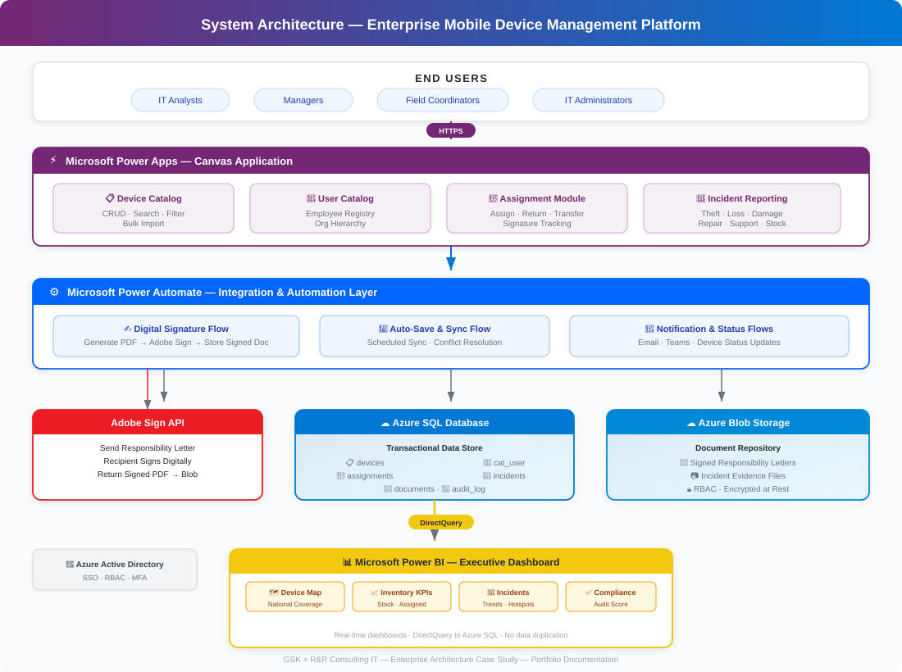
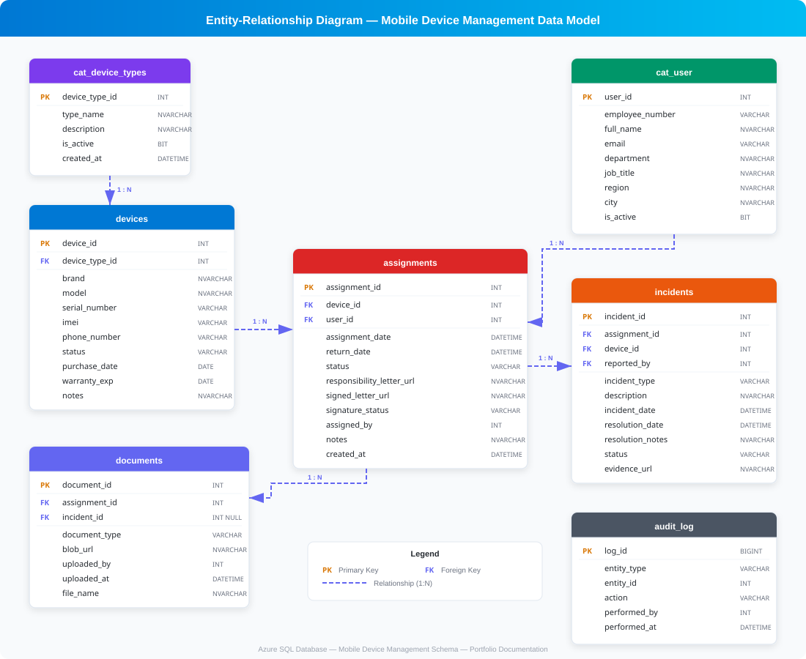

# 📱 Enterprise Mobile Device Management Platform — GSK × R&R Consulting IT


> **Case Study — Enterprise Architecture Portfolio**
> End-to-end design and delivery of a nationwide mobile device lifecycle management platform for a Fortune 500 pharmaceutical company, built on the Microsoft Power Platform and Azure cloud services.

---

## Table of Contents

- [Business Challenge](#business-challenge)
- [My Role](#my-role)
- [Solution Overview](#solution-overview)
- [Architecture](#architecture)
- [Data Model](#data-model)
- [Key Features](#key-features)
- [Automation & Integration Layer](#automation--integration-layer)
- [Analytics & Reporting](#analytics--reporting)
- [Impact & Results](#impact--results)
- [Tech Stack Summary](#tech-stack-summary)
- [Disclaimer](#disclaimer)

---

## Business Challenge

Before this initiative, GSK's IT operations team managed the assignment, tracking, and incident reporting of **thousands of mobile devices** (smartphones, tablets, and laptops) distributed to field operatives across Mexico using a patchwork of **disconnected spreadsheets, email threads, and manual file-sharing methods**.

This approach created several critical problems:

- **No single source of truth** — Device inventory, user assignments, and incident history lived in multiple Excel files owned by different analysts, leading to version conflicts and data loss.
- **Manual, error-prone processes** — Every device handoff required printing a responsibility letter, obtaining a wet signature, scanning the document, and filing it manually. Turnaround time averaged 3–5 business days.
- **Zero real-time visibility** — Leadership had no way to know, at any given moment, how many devices were in stock, in repair, lost, or stolen across the country.
- **Compliance risk** — Without centralized custody-chain documentation, audit readiness was low and personal data protection standards were difficult to enforce.
- **Scalability ceiling** — As headcount grew, the manual model could not keep pace, creating bottlenecks that delayed onboarding and increased operational cost.

---

## My Role

**IT Project Manager & Technical Architecture Lead**

I led this project end-to-end in collaboration with R&R Consulting IT, serving as the bridge between GSK's business stakeholders and the technical delivery team. My responsibilities included:

| Area | Scope |
|---|---|
| **Discovery & Requirements** | Conducted stakeholder interviews, mapped existing workflows, and translated business needs into a functional specification. |
| **Architecture Design** | Designed the cloud-based architecture on Azure (SQL Database + Blob Storage) and defined the integration layer between Power Apps, Power Automate, Adobe Sign, and Power BI. |
| **Data Modeling** | Created the relational data model to support device lifecycle management, user assignments, incident tracking, and document storage. |
| **App Development** | Built the Power Apps canvas application, including all screens, forms, galleries, and navigation. |
| **Automation Engineering** | Designed and implemented Power Automate flows for digital signatures (Adobe Sign), auto-save routines, and notification workflows. |
| **BI & Analytics** | Developed the Power BI dashboard connected to Azure SQL, including geographic distribution maps and KPI scorecards. |
| **Delivery & Handoff** | Managed UAT cycles, training sessions, and production deployment. |

---

## Solution Overview

A **centralized, cloud-native platform** built on Microsoft Power Platform that manages the complete lifecycle of corporate mobile devices — from procurement and assignment through incident management and decommissioning — with automated digital signature workflows and real-time executive dashboards.

### How It Works (High Level)

1. **Catalog Management** — Administrators maintain master catalogs of devices (by type, model, serial number) and authorized users (employees and contractors).
2. **Assignment Workflow** — When a device is assigned, the system triggers an automated flow that generates a responsibility letter, sends it to the recipient for digital signature via Adobe Sign, and stores the signed document in Azure Blob Storage.
3. **Incident Management** — Field operatives and analysts can report incidents (theft, loss, damage, repair, technical support) directly in the app, updating the device status in real time.
4. **Executive Dashboard** — A Power BI report connected to the Azure SQL data model provides leadership with live visibility into device distribution across the country, stock levels, incident trends, and compliance metrics.

---

## Architecture

### System Architecture Diagram



<!-- If the SVG doesn't render, see docs/architecture-diagram.svg -->

```
┌─────────────────────────────────────────────────────────────────────┐
│                        END USERS                                    │
│   Analysts · Managers · Field Coordinators · IT Administrators      │
└──────────────────────────┬──────────────────────────────────────────┘
                           │  HTTPS
                           ▼
┌─────────────────────────────────────────────────────────────────────┐
│                   MICROSOFT POWER APPS                              │
│              (Canvas App — Responsive UI)                           │
│                                                                     │
│  ┌──────────┐ ┌──────────────┐ ┌──────────┐ ┌──────────────────┐  │
│  │ Device   │ │  User        │ │Assignment│ │  Incident        │  │
│  │ Catalog  │ │  Catalog     │ │ Module   │ │  Reporting       │  │
│  └──────────┘ └──────────────┘ └──────────┘ └──────────────────┘  │
└──────────┬──────────────┬──────────────┬───────────────┬────────────┘
           │              │              │               │
           ▼              ▼              ▼               ▼
┌─────────────────────────────────────────────────────────────────────┐
│                   INTEGRATION LAYER                                 │
│                 Microsoft Power Automate                            │
│                                                                     │
│  ┌──────────────────┐  ┌────────────────┐  ┌────────────────────┐  │
│  │ Digital Signature │  │  Auto-Save &   │  │  Notification &   │  │
│  │ Flow (Adobe Sign) │  │  Sync Flow     │  │  Alert Flows      │  │
│  └────────┬─────────┘  └───────┬────────┘  └────────┬───────────┘  │
└───────────┼────────────────────┼─────────────────────┼──────────────┘
            │                    │                     │
            ▼                    ▼                     ▼
┌────────────────────┐  ┌─────────────────┐  ┌────────────────────────┐
│   ADOBE SIGN API   │  │   AZURE SQL     │  │  AZURE BLOB STORAGE    │
│   (e-Signature)    │  │   DATABASE      │  │  (Document Repository) │
│                    │  │                 │  │                        │
│  Send → Sign →     │  │  Device Data    │  │  Signed PDFs           │
│  Return Signed Doc │  │  User Data      │  │  Responsibility Letters│
│                    │  │  Assignments    │  │  Incident Evidence     │
│                    │  │  Incidents      │  │                        │
└────────────────────┘  └────────┬────────┘  └────────────────────────┘
                                 │
                                 ▼
                    ┌─────────────────────────┐
                    │      POWER BI           │
                    │   Executive Dashboard   │
                    │                         │
                    │  ✦ Device Distribution  │
                    │    Map (Mexico)         │
                    │  ✦ Inventory KPIs       │
                    │  ✦ Incident Analytics   │
                    │  ✦ Compliance Metrics   │
                    └─────────────────────────┘
```

### Architecture Decisions

| Decision | Rationale |
|---|---|
| **Power Apps (Canvas)** | Low-code platform aligned with GSK's existing Microsoft 365 licensing; rapid prototyping and deployment with minimal infrastructure overhead. |
| **Azure SQL Database** | Fully managed relational database with enterprise-grade security, automatic backups, and native connector support for Power Platform. |
| **Azure Blob Storage** | Cost-effective, scalable object storage for signed documents and evidence files, with role-based access control. |
| **Power Automate** | Native integration with Power Apps and Adobe Sign; enables complex multi-step workflows without custom middleware. |
| **Adobe Sign** | Enterprise e-signature solution compliant with Mexican legal standards (NOM-151); API integration enables round-trip document workflows. |
| **Power BI (DirectQuery)** | Real-time dashboards without data duplication; direct connection to Azure SQL ensures leadership always sees live data. |

---

## Data Model

### Entity-Relationship Diagram



<!-- If the SVG doesn't render, see docs/data-model.svg -->

```
┌────────────────────┐       ┌─────────────────────┐
│     cat_device_     │       │     cat_user         │
│       types         │       │                      │
├────────────────────┤       ├──────────────────────┤
│ PK  device_type_id │       │ PK  user_id          │
│     type_name      │       │     employee_number   │
│     description    │       │     full_name         │
│     is_active      │       │     email             │
└────────┬───────────┘       │     department        │
         │ 1:N               │     job_title         │
         ▼                   │     region            │
┌────────────────────┐       │     city              │
│     devices        │       │     is_active         │
├────────────────────┤       └──────────┬────────────┘
│ PK  device_id      │                 │
│ FK  device_type_id │                 │
│     brand          │                 │
│     model          │                 │
│     serial_number  │                 │
│     imei           │                 │
│     phone_number   │                 │
│     status         │    1:N          │ 1:N
│     purchase_date  │◄────────┐       │
│     warranty_exp   │         │       │
│     notes          │         │       │
└────────┬───────────┘         │       │
         │                     │       │
         │ 1:N                 │       │
         ▼                     │       ▼
┌──────────────────────────────┴───────────────────┐
│                  assignments                      │
├───────────────────────────────────────────────────┤
│ PK  assignment_id                                 │
│ FK  device_id                                     │
│ FK  user_id                                       │
│     assignment_date                               │
│     return_date                                   │
│     status  (Active / Returned / Transferred)     │
│     responsibility_letter_url  (Blob Storage)     │
│     signed_letter_url          (Blob Storage)     │
│     signature_status (Pending / Signed / Expired) │
│     assigned_by                                   │
│     notes                                         │
└──────────────────────┬────────────────────────────┘
                       │ 1:N
                       ▼
┌───────────────────────────────────────────────────┐
│                   incidents                        │
├───────────────────────────────────────────────────┤
│ PK  incident_id                                    │
│ FK  assignment_id                                  │
│ FK  device_id                                      │
│ FK  reported_by  (user_id)                         │
│     incident_type  (Theft / Loss / Damage /        │
│                     Repair / Tech Support / Stock)  │
│     description                                    │
│     incident_date                                  │
│     resolution_date                                │
│     resolution_notes                               │
│     status  (Open / In Progress / Resolved)        │
│     evidence_url  (Blob Storage)                   │
└────────────────────────────────────────────────────┘

┌───────────────────────────────────────────────────┐
│                  documents                         │
├───────────────────────────────────────────────────┤
│ PK  document_id                                    │
│ FK  assignment_id                                  │
│ FK  incident_id  (nullable)                        │
│     document_type  (Responsibility Letter /        │
│                     Incident Report / Other)       │
│     blob_url                                       │
│     uploaded_by                                    │
│     uploaded_at                                    │
│     file_name                                      │
│     file_size_kb                                   │
└────────────────────────────────────────────────────┘

┌───────────────────────────────────────────────────┐
│                  audit_log                          │
├───────────────────────────────────────────────────┤
│ PK  log_id                                         │
│     entity_type  (Device / Assignment / Incident)  │
│     entity_id                                      │
│     action  (Create / Update / Delete)             │
│     performed_by                                   │
│     performed_at                                   │
│     details_json                                   │
└────────────────────────────────────────────────────┘
```

### Key Schema Notes

- **`devices.status`** uses a controlled vocabulary: `Available`, `Assigned`, `In Repair`, `Stolen`, `Lost`, `Damaged`, `Decommissioned`.
- **`assignments.signature_status`** tracks the Adobe Sign round-trip: `Pending` → `Sent` → `Signed` → `Expired`.
- **`documents.blob_url`** stores the full Azure Blob Storage URI, enabling direct retrieval from Power Apps.
- **`audit_log`** captures every state change for compliance and traceability.

---

## Key Features

### 1. Device Catalog Management

Full CRUD operations on the master device inventory — add, edit, search, filter, and deactivate devices by type, brand, model, serial number, or IMEI. Supports bulk import for large-scale procurement events.

### 2. User Catalog Management

Centralized registry of all employees and contractors authorized to receive corporate devices. Linked to organizational hierarchy (department, region, city) to enable geographic reporting.

### 3. Device Assignment Workflow

End-to-end assignment process: select a device → select a user → generate a responsibility letter → trigger digital signature → store signed document → update device status. All within a single application flow.

### 4. Incident Reporting Module

Structured incident capture with typed categories (Theft, Loss, Damage, Repair, Technical Support, Stock Return). Each incident is linked to a specific device and assignment, creating a complete audit trail. Supports evidence file uploads to Blob Storage.

### 5. Digital Signature Integration

Automated round-trip workflow with Adobe Sign — the system sends the responsibility letter, the recipient signs on any device, and the signed PDF is automatically returned and stored. No paper, no scanning, no manual filing.

### 6. Auto-Save & Sync

Background Power Automate flows ensure data consistency between Power Apps and Azure SQL, with automatic conflict resolution and retry logic.

---

## Automation & Integration Layer

### Power Automate Flows

| Flow Name | Trigger | Process |
|---|---|---|
| **`FL_SendForSignature`** | New assignment created | Generates PDF → Sends to Adobe Sign → Monitors signature status → Stores signed doc in Blob Storage → Updates `assignments` table. |
| **`FL_AutoSaveSync`** | Scheduled (every 5 min) | Syncs offline changes from Power Apps local cache to Azure SQL. |
| **`FL_IncidentNotification`** | New incident reported | Sends email/Teams notification to IT Manager and Regional Coordinator with incident details. |
| **`FL_DeviceStatusUpdate`** | Incident resolution | Updates `devices.status` based on incident outcome (e.g., returned from repair → `Available`). |

### Integration Architecture

```
Power Apps  ──►  Power Automate  ──►  Adobe Sign API
                      │                     │
                      │               ◄─────┘  (Signed PDF callback)
                      │
                      ├──►  Azure SQL  (Data persistence)
                      │
                      └──►  Azure Blob Storage  (Document storage)
```

---

## Analytics & Reporting

### Power BI Dashboard

Connected to Azure SQL via **DirectQuery** for real-time data. The dashboard includes:

| Report Page | Description |
|---|---|
| **National Overview** | Interactive map of Mexico showing device distribution by state and city, color-coded by device status. |
| **Inventory KPIs** | Total devices, devices in stock, assigned, in repair, lost/stolen. Month-over-month trends. |
| **Assignment Activity** | New assignments, returns, and transfers over time. Average time-to-sign metrics. |
| **Incident Analytics** | Incident volume by type, region, and resolution time. Identifies hotspots for theft and damage. |
| **Compliance Scorecard** | Percentage of assignments with signed responsibility letters. Audit readiness indicator. |

---

## Impact & Results

| KPI | Before | After | Improvement |
|---|---|---|---|
| **Device Assignment Turnaround** | 3–5 business days | < 4 hours | **~95% reduction** |
| **Signature Completion Rate** | ~60% (manual process) | 98% (digital) | **+38 percentage points** |
| **Inventory Visibility** | Fragmented (multiple spreadsheets) | Real-time, single source of truth | **100% centralized** |
| **Incident Response Time** | 48–72 hours (email-based) | < 8 hours (in-app + automated alerts) | **~85% reduction** |
| **Audit Readiness** | Low (missing documents) | High (all documents digitized and stored) | **Compliance-ready** |
| **Devices Under Management** | ~2,000 (estimated) | 3,500+ (verified) | **Full national coverage** |
| **Manual Data Entry Hours / Month** | ~120 hours | ~15 hours | **~87% reduction** |

---

## Tech Stack Summary

| Layer | Technology | Purpose |
|---|---|---|
| **Frontend** | Microsoft Power Apps (Canvas) | User interface for all CRUD and workflow operations |
| **Backend / Logic** | Microsoft Power Automate | Workflow orchestration, API integrations, scheduled jobs |
| **Database** | Azure SQL Database | Relational data store for all transactional data |
| **File Storage** | Azure Blob Storage | Document repository for signed PDFs and evidence files |
| **e-Signature** | Adobe Sign (API) | Digital signature workflow for responsibility letters |
| **Analytics** | Microsoft Power BI (DirectQuery) | Executive dashboards and operational reporting |
| **Identity** | Azure Active Directory | Authentication and role-based access control |
| **Cloud** | Microsoft Azure | Hosting, networking, and security infrastructure |

---

## Disclaimer

> **⚠️ Confidential Application** — This repository contains **only architectural documentation and data model references** for portfolio and educational purposes. The actual Power Apps application, Power Automate flows, Power BI reports, and all associated data are proprietary to GSK and are not included in this repository. All data shown in diagrams is **fictional and illustrative**. No confidential, proprietary, or personal data has been disclosed.

---

## About the Author

**Role:** IT Project Manager & Technical Architecture Lead
**Engagement:** R&R Consulting IT → GSK (Nearshore)
**Focus Areas:** Enterprise Architecture · Systems Integration · Power Platform · Azure Cloud · Business Intelligence

---

<p align="center">
  <i>Built with ☁️ on the Microsoft Power Platform + Azure</i>
</p>
